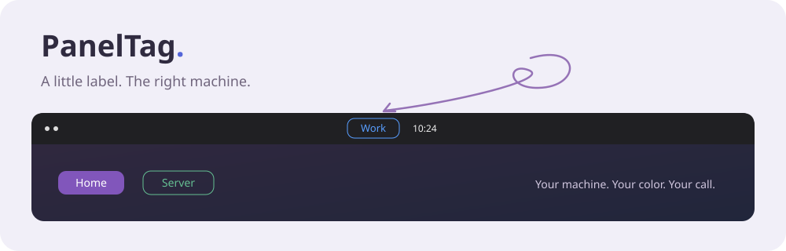

<p align="center"></p>

<p align="center">Work, Home, Lab — know which computer you’re using.<br>A little badge for Ubuntu, macOS, and Windows.</p>

<p align="center"><a href="https://afshinki.github.io/PanelTag/">See it & download</a> · <a href="https://github.com/AfshinKI/PanelTag/releases/tag/v0.5.0">All downloads</a></p>

## Install

- **Ubuntu GNOME:** download the `.deb`, then run `sudo apt install ./paneltag_0.5.0_all.deb`. Log out and back in if needed.
- **macOS 13+:** open the universal `.dmg`, drag PanelTag to Applications, then open it. Works on Intel and Apple silicon.
- **Windows:** run the x64 or ARM64 installer and launch PanelTag. It shows a floating badge and a tray icon.

The first Mac and Windows releases are not signed with publisher certificates. macOS or Windows may show a security prompt. See the [release notes](https://github.com/AfshinKI/PanelTag/releases/tag/v0.5.0) for installation details and testing limits.

Optional Mac terminal install (only if you trust the unsigned release):

```sh
curl -fsSL https://afshinki.github.io/PanelTag/install-macos.sh | bash -s -- --allow-unsigned
```

This verifies the download, installs into `~/Applications`, and removes quarantine **only from PanelTag**. It does not disable Gatekeeper.

## Make it yours

All platforms share the same compact settings layout. **Right-click the badge** to change its name, color, icon, text size, and style. It follows your system accent by default. Turn **Start at login** on or off in the menu; **Quit PanelTag** closes it for the current session.

Ubuntu and Windows offer left/middle/right placement. On Mac, hold Command and drag the badge within the menu bar.

Free and open source. No account or tracking. Designed by **Afshin K.I.**

[Report a bug](https://github.com/AfshinKI/PanelTag/issues) · [Developer guide](docs/DEVELOPING.md) · [MIT license](LICENSE)
