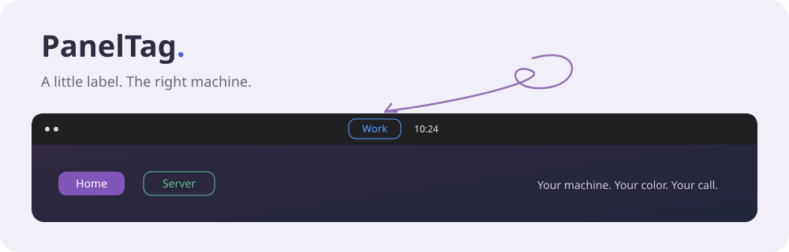

<p align="center"></p>

<p align="center"><strong>Work laptop? Home desktop? That server you keep mixing up?</strong><br>Give each machine a little name badge that stays in sight.</p>

<p align="center">Designed by <strong>Afshin K.I.</strong></p>

<p align="center"><a href="https://afshinki.github.io/PanelTag/"><strong>🎨 Play with the demo</strong></a> &nbsp; · &nbsp; <a href="https://github.com/AfshinKI/PanelTag/releases/tag/v0.2.6"><strong>↓ Get PanelTag</strong></a> &nbsp; · &nbsp; <a href="LICENSE">MIT licensed</a></p>

## Small badge. Plenty of personality.

- **Name it.** Work, Home, Lab — or tap the small computer button beside the name field to use your hostname.
- **Color it.** Choose a preset or your own hex color.
- **Match your desktop.** System color is on by default from first launch, with no setup required. PanelTag reads the shell theme’s selection accent and follows theme changes; if the theme exposes no accent, it uses a light/dark fallback. Picking a badge color overrides this; Restore returns to System. Existing saved preferences are preserved.
- **Style it.** Filled, outline, or text only. Computer, laptop, server, or no icon.
- **Place it.** Left, middle, or right, with three text sizes.
- **Forget about it.** It enables itself at login and remembers your choices.

Right-click the badge for its compact settings menu: icon-only choices, circular colors, and separate rows for position, size and style. Left-click and keyboard activation work too. Hover to see the hostname. The × button beside Reset closes PanelTag for this session. Reopen it from the app launcher; it returns next login if Start at login is enabled.

**Our favorite starting point:** middle · no icon · medium text · system-color outline.

## One download for Ubuntu GNOME

[**Download PanelTag .deb ↓**](https://github.com/AfshinKI/PanelTag/releases/download/v0.2.6/paneltag_0.2.6_all.deb)

The installer selects the appropriate GNOME engine automatically. Package targets include Ubuntu 20.04, 22.04, 24.04, 26.04 and 26.10 (GNOME 3.36–51). Newer/older versions remain compatibility previews until live-session testing. KDE, Cinnamon and MATE are not supported.

In your download folder:

```sh
sudo apt install ./paneltag_0.2.6_all.deb
```

After the first installation, log out and back in. PanelTag discovers and enables itself in your GNOME session. The **Start at login** switch is on by default; switch it off to prevent the badge returning at your next login. Your current badge stays visible. To enable it manually:

```sh
gnome-extensions enable paneltag@afshinki.github.io
```

That’s it — PanelTag returns at future logins. Download checksums from the [release page](https://github.com/AfshinKI/PanelTag/releases/tag/v0.2.6).

<details>
<summary>Taking the badge off?</summary>

Disable it with `gnome-extensions disable paneltag@afshinki.github.io`, or uninstall with `sudo apt remove paneltag`. Settings are stored per user through GSettings.

</details>

## Try before you install

The [interactive website](https://afshinki.github.io/PanelTag/) cycles through Work, Home and Server examples. Click the badge to try your own settings. The menu starts open and the simulated desktop stays the same size when you close it. After 8 seconds closed, the demo cycles through examples, occasionally opening the settings menu. Open the menu to take control, or click the badge to take control. The original landscape wallpaper is included as SVG.

The website is a browser preview, not a running GNOME session. The app and demo use compact icon-button rows. The first color circle follows system appearance; the rainbow circle opens a custom color picker. The example hostname is fictional. Nothing in the demo changes your computer.

## For the curious 🛠️

Build with Python 3, GLib tools and dpkg-deb:

```sh
bash scripts/build.sh
```

This builds one universal `.deb` and its checksum under `dist/`. The package selects `legacy/` for GNOME before 45 and `extension/` for GNOME 45–51. A package trigger refreshes that choice when GNOME Shell is upgraded.

To release: update both version fields in `extension/metadata.json`, update download links, and merge to `main`. CI builds packages, creates the matching version tag and publishes a prerelease if it does not exist. Explicit version tags also work. Promote releases after live desktop testing.

## Open source, no mystery ingredients

[MIT licensed](LICENSE). No account, API keys, analytics, external scripts, or backend are needed. Settings stay local. GitHub Pages publishes `site/`; GitHub Actions uses its automatic short-lived token, not a committed personal token. Credential files are ignored by Git.

Found a bug or tried an older Ubuntu release? [Tell us how it went](https://github.com/AfshinKI/PanelTag/issues) — include your Ubuntu and GNOME versions.

### One installer
The universal `.deb` selects legacy or modern GNOME code at install time and after GNOME Shell upgrades. It targets GNOME 3.36–51, including Ubuntu 20.04, 22.04, 24.04, 26.04 (GNOME 50) and 26.10 (GNOME 51). Compatibility on newer releases is a preview until tested in live sessions.

Search for **PanelTag** in your apps to enable it. Installation through `sudo apt` attempts activation in the invoking user's running session; graphical and unattended installers may require opening the launcher. A newly discovered extension still requires one logout/login on GNOME. The installer never restarts your session.
